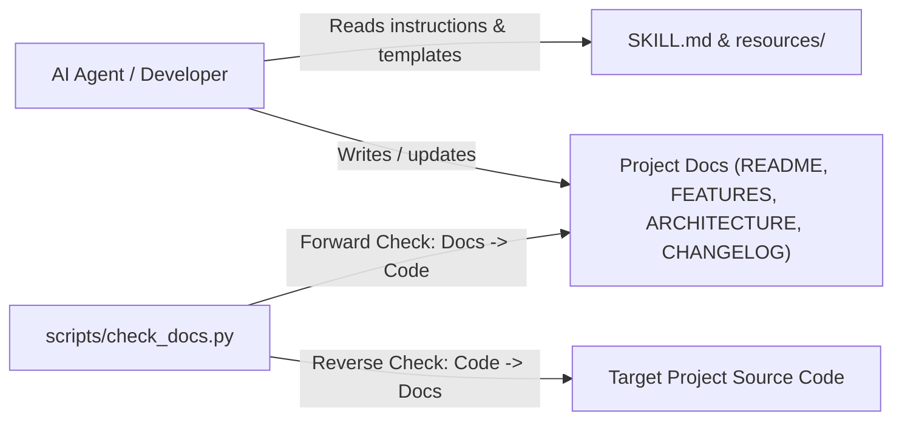

# Architecture and Design Decisions: `living-docs`

## 1. System Overview



`living-docs` consists of two parts: declarative agent instructions with bilingual Markdown templates (`SKILL.md`, `resources/en/`, `resources/id/`), and a standalone Python verification CLI (`scripts/check_docs.py`) that validates documentation against the repository's source tree.

---

## 2. CLI Interface Contract (`scripts/check_docs.py`)

| Flag | Default | Purpose |
| :--- | :--- | :--- |
| `--root <path>` | `.` | Root directory of the project to verify |
| `--docs <file ...>` | Auto-discovered | Explicit list of Markdown files to check instead of scanning `--root` |
| `--ignore <pattern>` | `[]` | Literal, glob, or regex pattern to ignore (repeatable) |
| `--skip-reverse` | `False` | Disable reverse coverage warnings (`Code -> Docs`) |
| `--allow-em-dash` | `False` | Allow em dashes (`\u2014`) in prose without raising an error |

### Exit Codes
* `0`: Zero errors found (warnings may be present on stdout).
* `1`: One or more forward verification errors found, or no documentation files exist in `--root`.

---

## 3. CLI Interface Contract (`scripts/bump_version.py`)

| Flag | Default | Purpose |
| :--- | :--- | :--- |
| `--root <path>` | `.` | Root directory of the target project |
| `--bump <patch\|minor\|major\|auto>` | Required (or `--set`) | Segment to increment (`auto` inspects `## [Unreleased]` headings in `CHANGELOG.md`) |
| `--set <X.Y.Z>` | None | Explicit Semantic Version to write instead of computing an increment |
| `--message <text>` | None | Fallback entry when `## [Unreleased]` is empty (e.g. `"Fixed: handle timeout"`) |
| `--date <YYYY-MM-DD>` | Today (ISO) | Release date written to `## [X.Y.Z] - YYYY-MM-DD` in `CHANGELOG.md` |
| `--create-version-file` | `False` | Create a `VERSION` file at `--root` if one does not exist yet |
| `--strict-major` | `False` | Allow `--bump auto` to jump `0.Y.Z -> 1.0.0` on breaking changes |
| `--dry-run` | `False` | Preview version transition and affected files without modifying disk |

---

## 4. Architecture Decision Records (ADR)

### ADR-01: Pragmatic 4-File Diataxis Consolidation
* **Context:** Strict Diataxis splits documentation into four separate directory trees (Tutorials, How-To Guides, Reference, Explanation). In small and medium repositories, strict separation creates many small stub files that developers and agents fail to keep updated.
* **Decision:** Consolidate the default documentation baseline into four files (`README.md`, `docs/FEATURES.md`, `docs/ARCHITECTURE.md`, `CHANGELOG.md`), placing Technical Reference, ADRs (Explanation), and the Operational Runbook (How-To) inside `docs/ARCHITECTURE.md` until a project grows large enough to split them out.
* **Consequences:** Every repository gets complete coverage of all four Diataxis quadrants with minimal file navigation. Very large repositories with dozens of ADRs or complex runbooks can split `docs/ADR.md` and `docs/RUNBOOK.md` when `docs/ARCHITECTURE.md` becomes too long. <!-- living-docs-ignore -->

### ADR-02: Zero-Dependency Python Standard Library Verifier
* **Context:** `living-docs` runs across diverse agent sandboxes (Claude Code, Google Antigravity, Cursor, CI containers) where installing Node.js or third-party Python packages (`pip install`) may be slow, restricted, or unavailable.
* **Decision:** Implement `scripts/check_docs.py` and `tests/test_check_docs.py` using only the Python 3 standard library (`argparse`, `fnmatch`, `os`, `re`, `sys`, `unittest`).
* **Consequences:** The verifier runs immediately on any machine with Python 3 installed without virtual environments or network access. Regex-based source scanning is slightly less precise than language-specific AST parsers, which is mitigated by built-in ignore directives (`FEAT-05`).

### ADR-03: Bilingual Template Directories (`resources/en/` and `resources/id/`)
* **Context:** Earlier versions mixed English skill instructions with Indonesian templates and status markers, causing mixed-language output when documenting English repositories.
* **Decision:** Maintain separate `resources/en/` and `resources/id/` template directories (with `resources/*.template.md` defaulting to English) and define an explicit marker translation table in `SKILL.md`.
* **Consequences:** Agents produce single-language documentation in either English or Indonesian while keeping identical structural headings and `FEAT-NN` / `ADR-NN` conventions.

---

## 5. Operational Runbook (Testing & Release)

### Running Verification and Unit Tests
```bash
python3 -m unittest discover -s tests -v
python3 scripts/check_docs.py --root .
```

### Cutting a Patch / Minor / Major Release
```bash
python3 scripts/bump_version.py --root . --bump patch
python3 scripts/check_docs.py --root .
```

### Updating Local Agent Skill Installations
If you maintain a local copy in `~/.gemini/config/skills/living-docs` or `~/.claude/skills/living-docs`, pull or copy the updated files from this repository:
```bash
cp -R SKILL.md resources scripts ~/.gemini/config/skills/living-docs/
```
