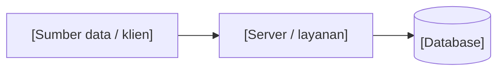
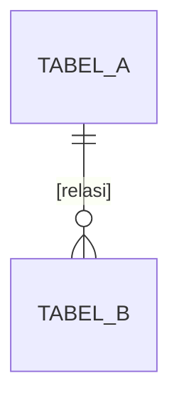

# Arsitektur, API, dan Model Data: [Nama Proyek]

## 1. Gambaran Sistem



[Dua sampai empat kalimat tentang alur data dari input sampai tampilan.]

---

## 2. Perangkat Keras dan Konfigurasi

Hapus bagian perangkat keras jika proyek tidak memakainya.

| Komponen | Pin / Port | Protokol | Fungsi |
| :--- | :--- | :--- | :--- |
| [Sensor] | [GPIO] | [I2C / Analog / 1-Wire] | [Yang diukur] |

| Variabel Lingkungan | Default | Kegunaan |
| :--- | :--- | :--- |
| `[NAMA_VAR]` | [nilai] | [fungsi] |

---

## 3. Kontrak API

| Method | Path | Autentikasi | Fungsi |
| :--- | :--- | :--- | :--- |
| `[GET]` | `/api/[path]` | [jenis] | [fungsi] |

### [METHOD] /api/[path]
[Kegunaan singkat.]

Request:
```json
{ }
```

Response 200:
```json
{ }
```

Error: [kode dan kondisi].

---

## 4. Pesan Realtime (WebSocket / MQTT / SSE)

Hapus jika tidak ada.

| Tipe Pesan | Arah | Kapan Dikirim |
| :--- | :--- | :--- |
| `[type]` | server ke klien | [kondisi] |

---

## 5. Model Data



### `[nama_tabel]`
| Kolom | Tipe | Keterangan |
| :--- | :--- | :--- |
| `id` | INTEGER PK | |

### Kunci Pengaturan
| Kunci | Default | Kegunaan |
| :--- | :--- | :--- |
| `[kunci]` | [nilai] | [fungsi] |

---

## 6. Keputusan Arsitektur (ADR)

Catat keputusan teknis penting supaya developer berikutnya tahu alasan di balik pilihan desain.

### ADR-01: [Judul Keputusan]
* **Konteks:** [Kendala atau masalah nyata yang dihadapi.]
* **Keputusan:** [Pilihan teknis yang diambil.]
* **Konsekuensi:** [Keuntungan dan kompromi/keterbatasan yang harus diterima.]

---

## 7. Runbook Operasional (Deploy, Backup, dan Pemulihan)

### Deployment Aman
```bash
[Perintah deploy yang menjaga data produksi, misalnya mengecualikan folder data/ dan .env.]
```

### Backup dan Restore Data
```bash
[Perintah backup database/state produksi.]
```

### Diagnosa Gangguan Umum
* **[Gejala 1]:** [Cara cek dan langkah perbaikan.]
