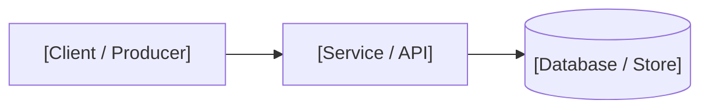
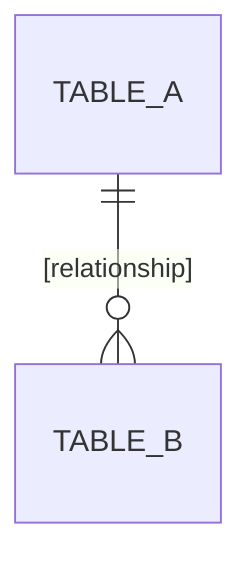

# Architecture, API, and Operations: [Project Name]

## 1. System Overview



[Two to four sentences describing the end-to-end data flow from input to storage/output.]

---

## 2. Environment & Hardware Configuration

| Environment Variable | Default | Purpose |
| :--- | :--- | :--- |
| `[VAR_NAME]` | `[value]` | [What it controls] |

<!-- Optional: Keep the hardware table below only for embedded/IoT projects; remove otherwise. -->
| Component | Pin / Port | Protocol | Purpose |
| :--- | :--- | :--- | :--- |
| `[Device/Sensor]` | `[Pin/Port]` | `[I2C / SPI / UART / GPIO]` | `[What it reads or controls]` |

---

## 3. API / Interface Contract

| Method | Path | Auth | Purpose |
| :--- | :--- | :--- | :--- |
| `GET` | `/api/[path]` | `[Bearer / Session / None]` | `[Summary]` |

### [METHOD] /api/[path]
[Short description of what the endpoint does.]

Request:
```json
{ }
```

Response 200:
```json
{ }
```

Errors: `[status codes and exact conditions]`.

---

## 4. Realtime / Async Messages (WebSocket / Queue / Events)

Remove this section if the project has no realtime or message-driven channels.

| Event / Topic | Direction | Trigger Condition |
| :--- | :--- | :--- |
| `[event.name]` | `server -> client` | `[When emitted]` |

---

## 5. Data Model



### `[table_name]`
| Column | Type | Notes |
| :--- | :--- | :--- |
| `id` | `INTEGER PK` | |

### Runtime Settings Keys
| Key | Default | Purpose |
| :--- | :--- | :--- |
| `[key]` | `[value]` | `[What it controls]` |

---

## 6. Architecture Decision Records (ADR)

Record non-obvious technical decisions so future maintainers know the constraints behind the design.

### ADR-01: [Decision Title]
* **Context:** [Concrete constraint or problem faced.]
* **Decision:** [Technical choice made.]
* **Consequences:** [Benefits gained and trade-offs accepted. If superseded later, mark `Superseded by ADR-MM`.]

---

## 7. Operational Runbook (Deploy, Backup, Recovery)

### Safe Deployment
```bash
[Deploy or release commands that preserve production state and secrets.]
```

### Backup and Restore
```bash
[Commands to back up and restore database or persistent state.]
```

### Troubleshooting Common Failures
* **[Symptom 1]:** [How to verify the cause and exact recovery steps.]
